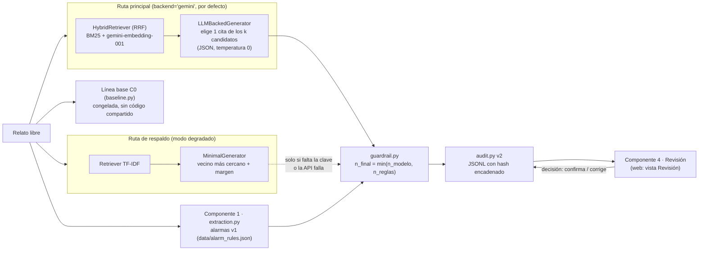

# TDSE · Copiloto de Triage RAG

Prototipo funcional de un copiloto de apoyo al triage de urgencias basado en
generación aumentada por recuperación (RAG). Recibe el relato libre de un
paciente en español y sugiere un nivel de triage (I–V, Resolución 5596 de 2015
de Colombia) **citando el fragmento normativo que lo respalda**, o se abstiene y
escala a un humano.

El sistema **asiste, no decide**. Principios no negociables, todos cubiertos
por pruebas:

- Nunca se emite un nivel sin una cita.
- Una cita que no esté entre los fragmentos recuperados produce abstención.
- El nivel siempre se deriva de la tabla propia `LEVEL_BY_CITATION`
  (`src/ingest.py`), nunca del texto del LLM.
- Ninguna abstención es silenciosa: siempre termina en escalamiento visible.
- La métrica de seguridad principal es el **sub-triage** (sugerir un nivel menos
  urgente que el de referencia).

## Arquitectura



**Flujo de `CopilotoPipeline.run_case` (`src/pipeline.py`):**

1. **Componente 1 – extracción de alarmas (`src/extraction.py`).** Normaliza el
   relato (minúsculas, sin tildes, léxico coloquial→clínico de
   `retrieval.py`) y detecta alarmas con las reglas de
   `data/alarm_rules.json` (con negación simple). `n_reglas` es el nivel más
   urgente entre las alarmas detectadas.
2. **Ruta principal (Gemini).** Recuperación híbrida: BM25 con el léxico
   clínico y `gemini-embedding-001` con codificación asimétrica
   consulta/documento, fusionados por Reciprocal Rank Fusion. Un LLM
   restringido elige **una cita de la lista recuperada** (salida JSON); el
   nivel sale de `LEVEL_BY_CITATION`.
3. **Ruta de respaldo (determinista).** TF-IDF + vecino más cercano con
   margen. Se activa **solo** si falta la clave o la API falla tras los
   reintentos, y queda marcada: `backend_used="deterministic_fallback"`,
   `degraded=True`. Pedir `backend="deterministic"` de forma explícita (E1–E4)
   se registra como `"deterministic"` y no es modo degradado.
4. **Guardarraíl (`src/guardrail.py`).** `n_final = min(n_modelo, n_reglas)`:
   solo puede **aumentar** la urgencia. Si gana la regla, la cita final es la
   de la regla y la del modelo queda en `model_citation`. Si el modelo se
   abstiene, se escala siempre (`escalated=True`); el nivel de la regla se
   muestra como referencia, no como sugerencia del modelo.
5. **Auditoría v2 (`src/audit.py`).** Cada evento guarda relato, fragmentos
   (id, score, rango), hash del corpus, modelos, versión del prompt, umbrales,
   alarmas, `n_modelo`/`n_reglas`/`n_final`, escalamiento y ruta usada, en un
   JSONL de solo anexado con **hash encadenado**. La decisión humana es un
   evento nuevo que referencia el hash de la sugerencia; nunca reescribe el
   original.
6. **Línea base C0 (`src/baseline.py` + `data/keyword_rules.json`)**:
   congelada, independiente y sin código compartido con el copiloto (una
   prueba verifica el hash de ambos archivos).

### ¿Por qué esta arquitectura?

- **Recuperación separada de generación.** Toda sugerencia debe ser trazable
  a una fuente citable; eso solo es verificable si la recuperación es una
  etapa independiente e inspeccionable, y si el LLM solo puede *elegir* entre
  los candidatos recuperados.
- **Híbrida BM25 + densa.** BM25 aporta coincidencia exacta de términos
  clínicos (con el léxico coloquial→clínico); los embeddings densos aportan
  robustez ante paráfrasis. RRF las combina sin calibrar escalas de score.
- **Respaldo determinista explícito.** El usuario nunca se queda sin respuesta
  por un fallo de red, pero la respuesta degradada queda marcada en la
  sugerencia, en la interfaz y en la auditoría.
- **Guardarraíl monótono con reglas propias.** Las alarmas explícitas (p. ej.
  ideación suicida con plan, déficit neurológico súbito) no dependen de que el
  modelo las "vea": `min()` garantiza por construcción que la regla solo sube
  la urgencia.
- **E1–E4 siguen siendo deterministas.** El estudio de recuperación del diseño
  2x2 debe ser reproducible sin red ni clave; por eso usa
  `backend="deterministic"` y sin guardarraíl de forma explícita. El efecto
  del guardarraíl se mide aparte (E6 frente a E5).
- **Capa web como presentación, no como despliegue.** `web/backend/` no
  implementa autenticación, multi-tenencia ni límites de tasa (fuera de
  alcance).

## Aviso importante

- El texto de `corpus/` es una **reconstrucción sintética**, elaborada por el
  equipo con fines académicos, de la estructura general de cinco niveles de
  triage y de señales de alarma usada en el sistema colombiano y en escalas
  internacionales comparables. **No es una transcripción literal ni oficial**
  de la Resolución 5596 de 2015 ni de ninguna guía clínica institucional.
- El conjunto de 74 viñetas de `data/cases.json` es sintético y fue etiquetado
  por el propio equipo (sin evaluadores clínicos externos), con doble ciego
  intra-equipo y niveles I-II sobremuestreados (18 y 15 casos respectivamente,
  ambos por encima del mínimo de 15 exigido en el documento del proyecto,
  Sección 5). Ya cumple el **rango de 60-100 casos** que pide el protocolo
  original — lo que sigue faltando, y es la brecha real, es que el doble
  ciego lo hizo el propio equipo y no evaluadores clínicos externos: sirve
  para ejercitar el pipeline y la maquinaria de métricas de extremo a
  extremo, **no** para sostener una afirmación de seguridad clínica real.
- Este software es un prototipo académico. **No debe usarse para tomar
  decisiones clínicas reales.**

## Instalación

Requiere Python 3.10+. El núcleo (`src/`, `experiments/`) solo usa la
biblioteca estándar. Las únicas dependencias opcionales viven aparte:
`web/backend/requirements.txt` (API web) y `requirements-embeddings.txt`
(adaptador de embeddings locales `src/local_embeddings.py`, no usado por
defecto).

```bash
git clone <url-del-repositorio>
cd TDSE_Copiloto_de_Triage_RAG
python -m unittest discover -s tests -v       # pruebas (sin red y sin clave)
python -m experiments.validate_cases          # valida el gold standard
python -m experiments.run_experiment          # E1-E6 + C0 (E5-E6 requieren clave o caché)
python -m experiments.compare_backends        # ruta determinista vs. Gemini
python -m experiments.analyze_external_data   # dataset real (ver abajo)
python demo.py "el paciente tiene dolor en el pecho y sudoracion fria"
python gui.py                                 # interfaz grafica
pip install -r web/backend/requirements.txt pytest && python -m pytest web/backend/tests
```

## Interfaz gráfica

`gui.py` es una interfaz de escritorio (Tkinter, incluido en la instalación
estándar de Python; no agrega dependencias) con tres pestañas, cada una
envolviendo un punto de entrada ya existente del prototipo — no duplica
lógica, solo la expone visualmente:

1. **Consulta individual**: caja de texto para el relato del paciente,
   selector de corpus (`raw`/`reformatted`), de embeddings
   (`generic`/`clinical_es`) y de ruta (`gemini` preseleccionada; si no está
   disponible se muestra el aviso de MODO DEGRADADO), y un botón que muestra la sugerencia del
   copiloto (nivel + cita, o abstención con su razón), los fragmentos
   recuperados con su score, y la sugerencia de la línea base C0 para
   comparar. Es el equivalente gráfico de `demo.py`.
2. **Experimento**: un botón que corre las celdas E1-E6 (E5-E6 solo desde la
   caché, sin gastar cuota de la API) más C0 sobre
   `data/cases.json` y muestra la misma tabla de resultados que
   `python -m experiments.run_experiment`.
3. **Dataset real**: un botón que analiza
   `data/external_triage_urgencias_colombia.csv` y muestra el mismo resumen
   que `python -m experiments.analyze_external_data` (distribución de
   niveles, tiempos de atención, y la prueba chi-cuadrado por red de IPS).

Cada botón corre el cómputo en un hilo en segundo plano para no congelar la
ventana; los resultados se entregan de vuelta al hilo principal de Tkinter
con `widget.after(...)`, que es la forma segura de actualizar la interfaz
desde un hilo secundario.

```bash
python gui.py
```

## Interfaz web (React + TypeScript)

Además de la interfaz de escritorio, el proyecto incluye una interfaz web más
elaborada (`web/frontend/`, React 19 + TypeScript + Vite + Tailwind CSS v4 +
Recharts) respaldada por una API REST (`web/backend/`, FastAPI). A diferencia
del resto del pipeline, **esta capa sí tiene dependencias de terceros**,
aisladas a propósito en sus propios `requirements.txt`/`package.json`: el
pipeline principal (`src/`, `experiments/`, `demo.py`, `gui.py`) sigue
funcionando exactamente igual, con o sin esta interfaz.

La API no contiene lógica propia: cada endpoint llama a las mismas funciones
que ya usan `demo.py`, `gui.py` y `experiments/*.py` (ver
"¿Por qué esta arquitectura?" — el mismo principio de no duplicar el
pipeline aplica aquí).

### Cinco vistas

1. **Revisión** (componente 4) — relato → sugerencia con nivel, cita y el
   texto íntegro del fragmento citado, alarmas detectadas, fragmentos
   recuperados (plegables), y avisos visibles de **modo degradado**,
   **escalamiento a revisión prioritaria** y **nivel elevado por regla de
   alarma**. La decisión exige una **elección activa** (no hay botón de
   aprobar con un clic): "Confirmar nivel" o "Corregir nivel"; corregir exige
   un nivel I–V y un motivo, y "Registrar decisión" está deshabilitado hasta
   que la elección es válida. Mide el tiempo de revisión y registra la
   decisión como evento encadenado en la auditoría (`POST /api/decision`).
   Texto fijo: "Sugerencia de apoyo. La clasificación final es
   responsabilidad del profesional de salud."
2. **Consulta individual** — igual que la pestaña homónima de `gui.py`, con
   selector de corpus/embeddings/backend, tarjeta de confianza con barra de
   progreso, y lista de fragmentos recuperados ordenados por score.
3. **Experimento** — corre `run_experiment` vía la API (E5-E6 solo desde caché) y grafica S,
   sensibilidad I-II y recall@k por celda (gráfico de barras), además de la
   tabla completa.
4. **Dataset real** — corre `analyze_external_data` vía la API: gráfico de
   la distribución real de niveles, gráfico de tiempos de atención por
   nivel, y tabla de distribución por red de IPS (con el resultado de la
   prueba chi-cuadrado).
5. **Corpus y casos** — explorador con buscador y filtros por nivel de las
   74 viñetas del gold standard, y visor del corpus normativo (crudo y
   reformateado), para inspeccionar exactamente qué evidencia respalda cada
   sugerencia.

### Cómo correrla

```bash
# Terminal 1: backend (API REST)
pip install -r web/backend/requirements.txt
uvicorn web.backend.app:app --reload --port 8000

# Terminal 2: frontend (Vite dev server, con proxy a /api hacia el puerto 8000)
cd web/frontend
npm install
npm run dev   # abre http://localhost:5173
```

Endpoints: `/api/health`, `/api/consulta` (devuelve además `record_hash`,
`backend_used`, `degraded`, `escalated`, `n_modelo`, `n_reglas`, `n_final`,
`alarms` y el texto del fragmento citado), `/api/decision`,
`/api/auditoria?limit=50` (últimos eventos, `verify_chain` y completitud),
`/api/experimento`, `/api/dataset`, `/api/casos`, `/api/corpus`. El registro
web es `results/audit_web_v2.jsonl` (excluido de git).

`web/backend/tests/test_app.py` prueba los endpoints (incluidas las
validaciones 422/404 y el flujo consulta → decisión → auditoría) con
`fastapi.testclient.TestClient` (requiere las dependencias de
`web/backend/requirements.txt`; no forma parte de la suite principal
`tests/`, que sigue sin dependencias). El frontend se verificó manualmente
end-to-end en navegador (las cuatro vistas, con datos reales) durante el
desarrollo.

## Ruta principal (Gemini): configuración y reproducibilidad

### Variables de entorno

| Variable | Por defecto | Uso |
|---|---|---|
| `GEMINI_API_KEY` | (ninguna) | Clave de la API. Sin ella (y sin caché), cada caso usa el respaldo determinista, marcado como modo degradado. |
| `GEMINI_GENERATION_MODEL` | `gemini-2.5-flash-lite` | Modelo de generación, fijado a un ID estable (sin alias `-latest`). |
| `GEMINI_EMBEDDING_MODEL` | `gemini-embedding-001` | Modelo de embeddings. |
| `GEMINI_CACHE_MODE` | `readwrite` | Modo de las cachés del LLM y de embeddings (ver abajo). |

**ID usado en la evaluación:** los resultados de E5-E6 registran el modelo
exacto en cada evento de auditoría (`generation_model`, `embedding_model`,
`prompt_version`) y en la sección "Versiones" de `results/summary.md`. Con la
configuración por defecto es `gemini-2.5-flash-lite` + `gemini-embedding-001`
con el prompt `triage-selector-v1`. Si el equipo usa otro ID, debe fijarlo con
`GEMINI_GENERATION_MODEL` antes de correr el experimento y reportarlo.

Otros detalles de reproducibilidad: temperatura 0; la clave viaja en el
encabezado `x-goog-api-key` (nunca en la URL); reintentos con backoff ante
429 y 5xx (respetando el `retryDelay` que sugiere la API en un 429) y timeout
de 30 s.

### Cómo configurar la clave (nunca la commitees)

```powershell
# PowerShell (Windows)
$env:GEMINI_API_KEY = "tu-key-aqui"
```

```bash
# bash / zsh / Git Bash
export GEMINI_API_KEY="tu-key-aqui"
```

El proyecto no carga `.env` automáticamente. **Nunca** pongas la clave en
`.env.example` (está versionado) ni en ningún archivo commiteado: una clave
commiteada queda en el historial para siempre. Si se filtra, revócala en Google
AI Studio y genera otra.

### Cachés y modos (`GEMINI_CACHE_MODE`)

- `data/.llm_response_cache.json`: respuestas del LLM, con clave
  `sha256(modelo + PROMPT_VERSION + prompt)`.
- `data/.gemini_embedding_cache.json`: embeddings del corpus **y de las
  consultas**, con clave `modelo:task_type:hash(texto)`.

Ambas están en `.gitignore`. Modos:

- `readwrite` (por defecto): usa la caché y guarda lo nuevo.
- `readonly`: repetición sin red; si falta una entrada, se lanza
  `LLMUnavailableError` (y el caso cae al respaldo, marcado como degradado).
- `off`: ni lee ni escribe.

`PROMPT_VERSION` (`src/llm_generator.py`) debe subirse cada vez que cambie el
prompt, para no reutilizar respuestas de un prompt anterior.

### Comparación determinista vs. Gemini

`python -m experiments.compare_backends` corre ambas rutas sobre las mismas
viñetas. Los casos en que la ruta Gemini cae al respaldo se reportan **en una
columna aparte** y no se mezclan con los de Gemini; la comparación justa es
Gemini frente al determinista **sobre los mismos casos** que respondió Gemini.

Una medición previa (commit `6195112`, con `gemini-flash-lite-latest`, solo
embeddings densos y sin guardarraíl; no reproducible con la configuración
actual) dio, sobre 74 casos: cobertura 0.56 → 0.91, S 0.108 → 0.017,
sensibilidad I-II 0.394 → 0.848, recall@k 0.667 → 0.894. Las cifras de la
configuración actual (híbrida + modelo fijo) se obtienen con las celdas E5-E6.

## Estructura del repositorio

```
corpus/
  raw/            Guías en formato crudo (tablas y flujogramas sin reformatear)
  reformatted/    Las mismas guías con citas explícitas (31 fragmentos)
data/
  cases.json                 74 viñetas sintéticas con gold standard intra-equipo
  cases_nuevos.template.json Plantilla VACÍA para casos nuevos del equipo (validación de alarmas v1)
  keyword_rules.json         Línea base C0, congelada (no se modifica)
  alarm_rules.json           Reglas de alarma v1 del guardarraíl (separadas de C0)
  external_triage_urgencias_colombia.csv  Dataset real de Datos Abiertos Colombia
src/
  ingest.py          Corpus -> fragmentos citables; LEVEL_BY_CITATION; corpus_hash()
  extraction.py      Componente 1: normalización y detector de alarmas con negación
  retrieval.py       TF-IDF, BM25Retriever, GeminiRetriever, DenseRetriever, HybridRetriever (RRF)
  local_embeddings.py Adaptador OPCIONAL de embeddings locales (E5), carga perezosa
  generator.py       Suggestion + MinimalGenerator (respaldo determinista)
  llm_client.py      Cliente de Gemini (urllib): modelo fijo, temperatura 0, caché, reintentos
  llm_generator.py   LLMBackedGenerator (ruta principal) y PROMPT_VERSION
  guardrail.py       Guardarraíl monótono min(n_modelo, n_reglas)
  pipeline.py        CopilotoPipeline: alarmas -> ruta principal/respaldo -> guardarraíl -> auditoría
  audit.py           Auditoría v2: hash encadenado, decisiones, verify_chain, completeness
  metrics.py         S, S pareado, sobre-triage, sensibilidad, recall@1/@k, MRR, bootstrap, McNemar
  baseline.py        Línea base C0 (congelada)
  stats.py           Chi-cuadrado y tablas de contingencia (dataset externo)
experiments/
  run_experiment.py        E1-E6 + C0 (y --cases para evaluar E6 sobre casos nuevos)
  validate_cases.py        Valida un archivo de casos contra el esquema del paper
  compare_backends.py      Ruta determinista vs. Gemini (respaldo reportado aparte)
  analyze_external_data.py Análisis del dataset real
results/
  summary.md, raw_results.json   Salida de run_experiment.py
  audit_E*.jsonl                 Auditoría por celda (primera repetición en E5-E6)
  backend_comparison.md/json     Salida de compare_backends.py
  external_data_summary.md       Salida de analyze_external_data.py
tests/            Pruebas (sin red y sin clave: Gemini siempre simulado o inyectado)
demo.py           CLI de una consulta (ruta gemini por defecto; --backend deterministic)
gui.py            Interfaz de escritorio (Tkinter)
web/
  backend/        API REST (FastAPI), ver "Interfaz web"
  frontend/       Interfaz web (React + TypeScript + Vite + Tailwind + Recharts)
requirements-embeddings.txt  Dependencia opcional del adaptador de embeddings locales
```

## Fuentes de datos reales

Se buscaron activamente bases de datos reales que pudieran mejorar el
prototipo. El hallazgo central: **no existen historias clínicas reales de
triage con relato libre del paciente y de acceso abierto sin restricciones**
(por buenas razones de protección de datos de salud); lo que sí existe, y se
documenta aquí con honestidad sobre qué puede y qué no puede hacer cada
fuente:

### Integrado en este repositorio

- **[Clasificación en Triage Urgencias](https://www.datos.gov.co/Salud-y-Protecci-n-Social/Clasificaci-n-en-Triage-Urgencias/vt5n-eu2r)**
  (Datos Abiertos Colombia, dataset `vt5n-eu2r`, ~89.000 registros, acceso
  público sin credenciales vía API Socrata). Es un dataset **administrativo**:
  trae nivel de triage (I-V) y marcas de tiempo de ingreso/atención de una red
  de IPS, **no** el relato del paciente. Se descargó completo a
  `data/external_triage_urgencias_colombia.csv` y se analiza con
  `experiments/analyze_external_data.py` (resultado real en
  `results/external_data_summary.md`). Sirve para dos cosas que el documento
  del proyecto dejó como supuestos no verificados:
  - Confirma empíricamente que los niveles I-II son una fracción muy pequeña
    de los casos reales (~3.3% en este dataset), lo que justifica con datos —
    no solo con intuición — la decisión de sobremuestrearlos en
    `data/cases.json`.
  - Da una referencia real (aunque secundaria e ilustrativa) de tiempos de
    ingreso a atención por nivel, en lugar de las cifras puramente
    hipotéticas que el documento del proyecto declaraba explícitamente como
    no medidas.
  - Adicionalmente, una prueba de independencia chi-cuadrado (nivel de
    triage x red de IPS, implementada en `src/stats.py` sin dependencias
    externas) encuentra una diferencia estadísticamente significativa entre
    redes (χ² ≈ 2162, df = 12, p ≈ 0): por ejemplo, RED OCCIDENTE clasifica
    solo 3.1% de sus casos como Nivel IV, frente a 12.3% en RED NORTE. Esto
    sugiere heterogeneidad real en el criterio de clasificación entre redes,
    relevante para cualquier calibración futura del prototipo por región.

### Relevantes para una fase posterior (no integradas)

- **[MIMIC-IV-ED Demo](https://physionet.org/content/mimic-iv-ed-demo/2.2/)**
  (PhysioNet, 100 pacientes, acceso abierto sin credenciales): sí incluye
  motivo de consulta en texto libre, nivel ESI (1-5) y signos vitales — la
  estructura más parecida a lo que necesita el clasificador de texto del
  copiloto — pero está en **inglés** y de un hospital de EE. UU., por lo que
  no es sustituto de datos en español sin una traducción/adaptación cuidadosa
  (y sería una forma razonable de probar si la arquitectura generaliza a otro
  idioma). El dataset completo (~425.000 estancias) existe en PhysioNet pero
  requiere registro, entrenamiento en sujetos humanos y firma de un acuerdo de
  uso de datos (DUA).
- **[ClinText-SP](https://arxiv.org/pdf/2503.18594)** y
  **CoWeSe (Corpus Web Salud Español)**: corpus abiertos de texto clínico y
  biomédico en español (26M y ~750M tokens respectivamente), no específicos de
  triage. Son la ruta natural para entrenar un modelo real de embeddings
  clínicos en español y así reemplazar el léxico de normalización de
  `retrieval.py` (modo `clinical_es`) por un modelo real, cerrando la brecha
  G1 del documento del proyecto.
- **[CARMEN-I](https://www.ncbi.nlm.nih.gov/pmc/articles/PMC12215073/)**:
  2.000 documentos clínicos anonimizados del Hospital Clínic de Barcelona en
  español/catalán (informes de alta, interconsultas, radiología). Útil para
  NER/anonimización, no para triage específicamente.

Ninguna de estas fuentes internacionales sustituye la necesidad, señalada en
el documento del proyecto, de una validación clínica externa con
profesionales de salud colombianos sobre el dominio y la normativa
específicos de este prototipo.

## Diseño experimental

| Celda | Corpus | Recuperación | Generación | Guardarraíl | Red |
|---|---|---|---|---|---|
| C0 | — | — (reglas congeladas) | árbol de palabras clave | — | no |
| E1 | crudo | TF-IDF genérico | vecino más cercano | no | no |
| E2 | reformateado | TF-IDF genérico | vecino más cercano | no | no |
| E3 | crudo | TF-IDF + léxico clínico | vecino más cercano | no | no |
| E4 | reformateado | TF-IDF + léxico clínico | vecino más cercano | no | no |
| E5 | reformateado | híbrida BM25 + Gemini (RRF) | LLM que elige la cita | no | sí (o caché) |
| E6 | reformateado | híbrida BM25 + Gemini (RRF) | LLM que elige la cita | sí | sí (o caché) |

- **E1-E4 (estudio de recuperación, factorial 2x2):** formato del corpus ×
  modo de recuperación, con la ruta determinista explícita y sin red.
- **E5-E6 (ruta principal):** se corren 3 repeticiones: la primera con
  `GEMINI_CACHE_MODE=readwrite` (si hay clave) y las otras dos en `readonly`
  (repetición exacta sin red); se reporta la media y el rango. Si no hay clave
  ni caché, **no se calculan con el respaldo**: aparecen como "no evaluadas
  (sin API ni caché)". Sus métricas se calculan solo sobre los casos que
  respondió Gemini, y se reporta aparte la tasa de modo degradado.
- **Hipótesis pareadas:** H1 (E5/E6 frente a C0: S pareado y sensibilidad I-II
  con McNemar exacto) y H5 (E6 frente a E5: sensibilidad I-II con McNemar y
  sobre-triage pareado).
- **Casos nuevos:** las reglas de alarma con `"origen": "analisis_error_avance"`
  se derivaron de fallos observados en los 74 casos (C005, C052, C054, C056),
  así que su efecto en esos casos está sesgado a posteriori. Para validarlas,
  el equipo debe escribir casos nuevos en `data/cases_nuevos.json` (a partir
  de `data/cases_nuevos.template.json`) y correr
  `python -m experiments.run_experiment --cases data/cases_nuevos.json`, que
  evalúa solo E6 (y C0) sobre ellos.

## Métricas

- **Cobertura:** fracción de casos elegibles en que el sistema responde.
- **S (sub-triage ponderado):** media de `max(0, nivel_sugerido −
  nivel_referencia)` sobre los casos en que el sistema responde.
- **S pareado:** S de A y de B sobre el subconjunto en que **ambos** responden
  (evita premiar a quien se abstiene en los casos difíciles).
- **Sobre-triage:** simétrico a S (`max(0, referencia − sugerido)`).
- **Sensibilidad I-II:** de los casos de referencia I o II, fracción sugerida
  también como I o II; **la abstención cuenta como fallo**.
- **Recall@1, recall@k (k=5) y MRR** del fragmento de referencia.
- **Fidelidad de citación**, **abstención correcta** e **indebida**,
  **acuerdo exacto**.
- **Completitud del registro:** porcentaje de eventos de auditoría con todos
  sus campos obligatorios (`src/audit.py::completeness`).
- **IC bootstrap del 95 %** (2000 réplicas por casos, semilla 42) para S,
  sensibilidad I-II y recall@k; **McNemar exacto** (binomial) para comparar
  sensibilidades de forma pareada.
- **κ_w** (kappa ponderado cuadrático) del acuerdo intra-equipo.

## Resultados

Salida real de `python -m experiments.run_experiment` en esta versión
(`results/summary.md`). κ_w intra-equipo = 0.953. C0: S = 0.394
[0.242–0.561], sensibilidad I-II = 0.455 [0.273–0.606], sobre-triage 0.273.

| Celda | Cobertura | S [IC95] | S par. celda / C0 (n) | Sens. I-II [IC95] | McNemar vs C0 | Recall@1 | Recall@k [IC95] | MRR | Sobre-triage | Completitud | Degradado |
|---|---|---|---|---|---|---|---|---|---|---|---|
| E1 | 0.47 | 0.258 [0.097–0.419] | 0.258 / 0.516 (31) | 0.485 [0.303–0.667] | p=1.000 | 0.258 | 0.500 [0.379–0.621] | 0.353 | 0.258 | 1.00 | 0.00 |
| E2 | 0.41 | 0.074 [0.000–0.185] | 0.074 / 0.333 (27) | 0.212 [0.091–0.364] | p=0.077 | 0.288 | 0.561 [0.439–0.682] | 0.387 | 0.519 | 1.00 | 0.00 |
| E3 | 0.50 | 0.212 [0.091–0.364] | 0.212 / 0.545 (33) | 0.485 [0.303–0.667] | p=1.000 | 0.379 | 0.621 [0.500–0.742] | 0.464 | 0.212 | 1.00 | 0.00 |
| E4 | 0.56 | 0.108 [0.000–0.243] | 0.108 / 0.351 (37) | 0.394 [0.242–0.545] | p=0.774 | 0.409 | 0.667 [0.561–0.773] | 0.497 | 0.459 | 1.00 | 0.00 |
| E5 | no evaluada (sin API ni caché) | | | | | | | | | | |
| E6 | no evaluada (sin API ni caché) | | | | | | | | | | |

Lectura honesta:

- Con 66 casos elegibles los intervalos son anchos y se solapan: ninguna
  diferencia entre E1-E4 ni frente a C0 en sensibilidad I-II es
  estadísticamente significativa (McNemar p ≥ 0.077).
- El S bajo de E2/E4 se paga con cobertura baja: por eso se reporta el S
  pareado frente a C0 y la sensibilidad con la abstención como fallo.
- E5 y E6 (la ruta principal y la hipótesis del guardarraíl) quedan pendientes
  de una corrida con `GEMINI_API_KEY`; ver "Diseño experimental".
- **Nota de calibración (histórica):** al ampliar el corpus y el gold
  standard, el léxico de `clinical_es` y la línea base C0 se extendieron una
  sola vez antes de congelar resultados; se probó y **descartó** agregar
  bigramas al TF-IDF porque empeoraba la sensibilidad I-II (ver
  `src/retrieval.py`).

## Limitaciones (heredadas del documento del proyecto)

- El gold standard es intra-equipo, no una validación clínica externa. El
  κ_w reportado mide consistencia interna del criterio aplicado, no
  corrección clínica.
- El corpus normativo es una reconstrucción sintética reducida, no el texto
  oficial completo de la Resolución 5596 ni de guías clínicas institucionales.
- En E1-E4, el modo "embeddings clínicos en español" es un proxy determinista
  (TF-IDF + léxico de dominio), no un modelo de embeddings real. La ruta
  principal sí usa embeddings y un LLM reales de Gemini, pero depende de una
  API externa y su evaluación (E5-E6) es tan ilustrativa como la del diseño
  2x2 (74 casos, no concluyente estadísticamente).
- Las reglas de alarma v1 se evaluaron sobre los mismos 74 casos que
  motivaron parte de ellas: su efecto ahí está sesgado a posteriori hasta que
  se evalúen con `data/cases_nuevos.json`.
- La negación es simple (ventana de 3 palabras sin cruzar puntuación): no
  maneja, p. ej., "no come y no respira" (la segunda negación queda dentro de
  la ventana de la primera).
- La evaluación central (`run_experiment.py`, diseño 2x2) es 100% offline y
  por lotes; no mide latencia bajo concurrencia ni incluye un despliegue en
  producción. El backend Gemini sí depende de red, pero sigue evaluándose
  por lotes, no como servicio desplegado.
- El dataset externo real (`data/external_triage_urgencias_colombia.csv`) es
  administrativo y de una sola red de IPS reportante: no contiene relato de
  paciente, no es necesariamente representativo de todo el país, y no se usa
  para entrenar ni evaluar el clasificador de texto (ver "Fuentes de datos
  reales").

## Extensión a un despliegue real

**Ya implementado:** ruta principal Gemini (recuperación híbrida + LLM
restringido), respaldo determinista marcado, guardarraíl de alarmas,
auditoría encadenada y revisión humana con confirmación activa. Puntos de
extensión que quedan pendientes (fuera del alcance de este prototipo):

- Entrenar/usar un modelo de embeddings clínicos en español fijo y propio
  (p. ej. sobre ClinText-SP o CoWeSe, ver "Fuentes de datos reales") en vez
  de depender de la API de un proveedor externo — reduciría costo y
  dependencia de red, a cambio de mantenimiento propio del modelo.
- `data/cases.json` ya tiene 74 casos (dentro del rango de 60-100 del
  protocolo original), pero el doble ciego lo hizo el propio equipo. Repetir
  el etiquetado con evaluadores clínicos externos reales, siguiendo el
  esquema ya definido en cada registro (`evaluator1`, `evaluator2`,
  `resolution_method`, etc.), sigue siendo la brecha más importante para
  pasar de "prototipo funcional" a "evidencia de seguridad clínica real"
  (ver "Limitaciones").
- Validar la generalización de la arquitectura con MIMIC-IV-ED (en inglés)
  antes de intentar una validación clínica formal en español.
- Si se despliega el backend Gemini en producción: mover la API key a un
  gestor de secretos (no una variable de entorno de shell) y agregar límites
  de tasa/costo por IPS o por usuario.

## Licencia

MIT. Ver `LICENSE`.
